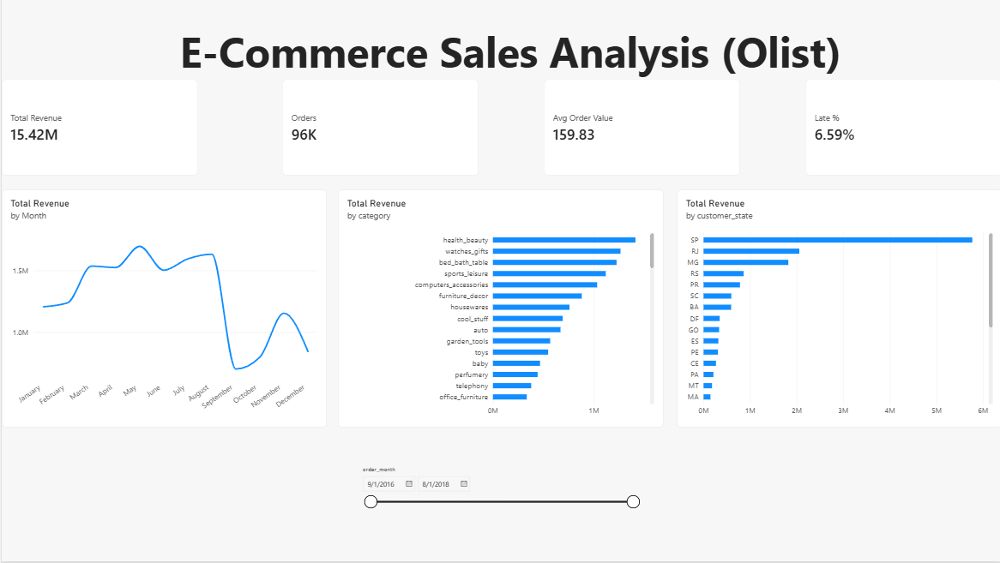

# E-Commerce Sales Analysis (Olist)


An end-to-end data project exploring Brazilian e-commerce data to uncover revenue trends, top-performing product categories, and the operational impact of delivery delays on customer satisfaction.

---

## 📊 Power BI Dashboard Preview


---

## 💡 Key Business Findings

1. **Monthly Revenue & Seasonality:** 
   Monthly revenue and order volume peak significantly during late-year sales events. Growth is driven primarily by an increase in total orders rather than higher average order values, which remain steady over time.
2. **Top Revenue Categories:** 
   A small subset of product categories drives the majority of platform revenue. Categories like *Health & Beauty* and *Watches & Gifts* serve as the primary financial anchors.
3. **Impact of Delivery Delays:** 
   Orders flagged as late experience a measurable drop in customer review scores, proving that fulfillment reliability is directly tied to customer satisfaction and brand trust.

---

## 🛠️ Technical Architecture & Pipeline Design

The project follows a standard modern data stack workflow: **Extract, Transform, Load (ETL)** via Python, storage in a **SQLite** database, and visualization in **Power BI**.

### 1. Data Cleansing & Filtering Decisions
* **Delivered Orders Only:** Non-delivered orders (such as cancelled or unavailable items) were filtered out because delivery metrics like `delivery_days` and `is_late` require actual fulfillment dates. Keeping them would corrupt logistics and revenue figures.
* **Review Aggregation:** Because certain orders contained multiple reviews, reviews were grouped and averaged at the `order_id` level before merging to prevent row-duplication and distorted revenue calculations.

### 2. Feature Engineering
The Python pipeline (`analysis.py`) creates custom analytical features to drive business reporting:
* **`revenue`:** Calculated as `price + freight_value` per order item.
* **`days_late`:** Difference between the estimated delivery date and the actual delivery date.
* **`is_late`:** A binary flag (`1` for late, `0` for on-time) enabling quick calculation of late order percentages.
* **`order_month`:** Timestamps converted into monthly periods to support time-series trend analysis.

---

## 📖 Glossary of Technical Terms

* **ETL Pipeline (Extract, Transform, Load):** A script (`analysis.py`) that pulls raw CSV files, cleans and restructures the data, and exports it into ready-to-use formats.
* **Fact Table:** A centralized table (`fact_sales`) structured at the order-item grain that combines transactional, product, customer, and review data for analysis.
* **Star Schema:** A database design pattern that organizes data into central fact tables connected to descriptive dimension attributes.
* **DAX (Data Analysis Expressions):** Custom formula language used in Power BI (e.g., `SUM`, `DISTINCTCOUNT`, `DIVIDE`) to create dynamic metrics.
* **SQL Window Functions:** Advanced SQL features (like `RANK()` or `ROW_NUMBER()`) that perform calculations across groups of rows without collapsing the dataset.
* **SQLite:** A lightweight, serverless file-based database (`olist.db`) used to run standard SQL queries locally without requiring database infrastructure.

---

## 🏗️ Analytics & ETL Workflow Architecture
```text
[Olist Raw CSV Files] (Customers, Orders, Items, Reviews)
         │
         ▼
[Data Ingestion & Cleaning] (`analysis.py` / Pandas)
         │
         ▼
[Metric Aggregation] (Monthly Revenue, AOV, State/Category Rankings, Delivery Delay Impact)
         │
         ▼
[Executive Dashboards & Reports] (Power BI `.pbix` & Visual Export Artifacts)
